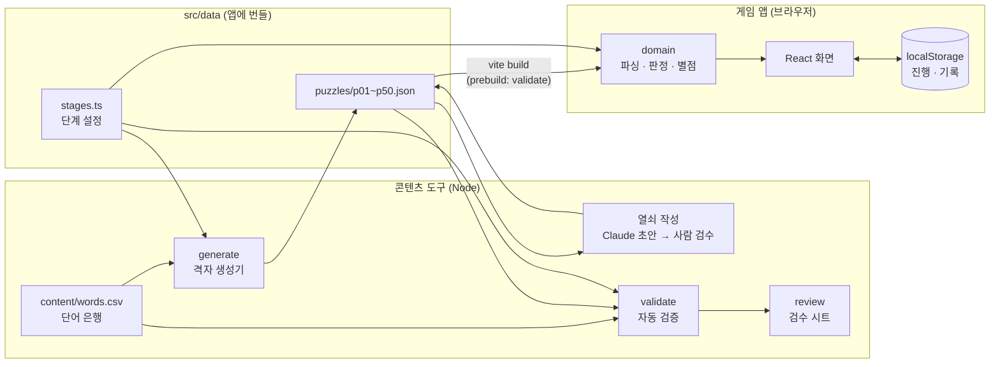
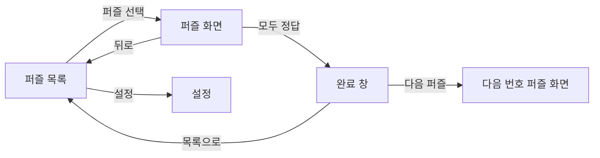
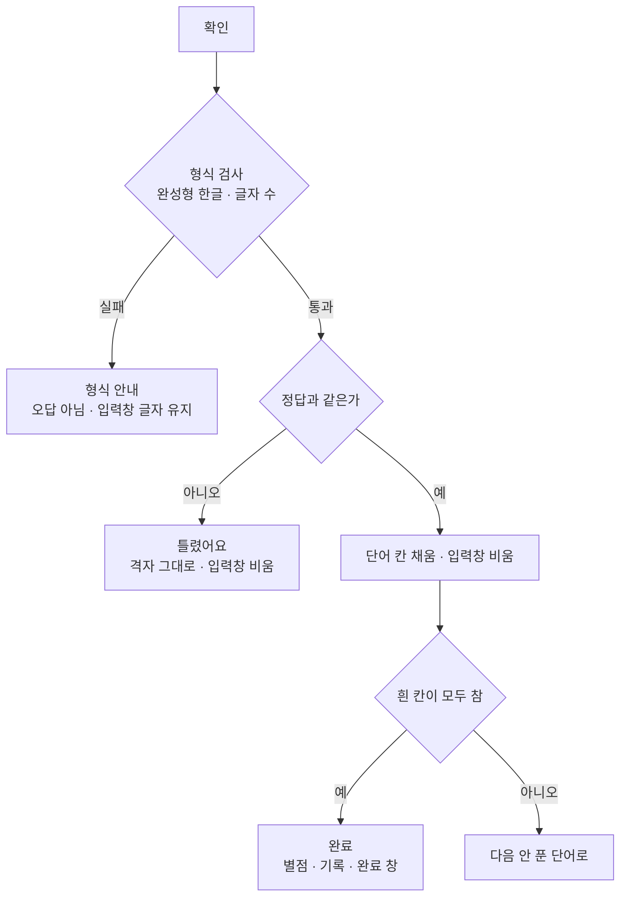
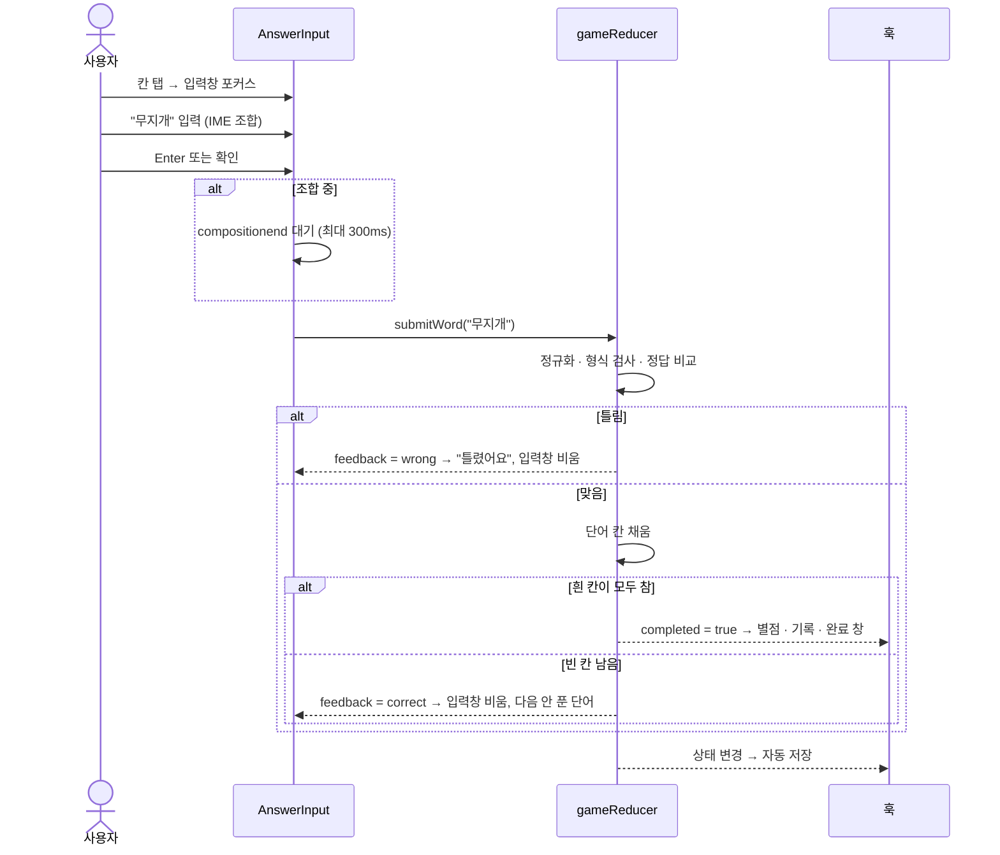

# 한글 가로세로 낱말 퍼즐 — 설계

> **상태**: 설계 v0.4 · **작성일**: 2026-11-13 · **변경**: v0.2 정답 판정을 단어마다 바로 판정으로 변경 · v0.3 틀리면 입력창을 비움 · v0.4 구현 반영(같은 뜻 묶음, F01, 시각 스타일 기본안, 생성기 규칙 보강)
> **근거**: [requirements.md](requirements.md) v0.5 (결정 D1~D14)
> **범위**: 구조·데이터·인터페이스·알고리즘. 구현 코드는 포함하지 않는다

## 0. 요약

- **두 부분으로 나뉜다.** ① 게임 앱 — React SPA, 서버 없이 정적 호스팅. ② 콘텐츠 도구 — 단어 은행 → 격자 생성 → 열쇠 작성 → 자동 검증 → 앱에 번들
- **핵심 결정**
  - 퍼즐은 **격자 문자열 + 정답별 열쇠** JSON으로 저장한다. 가로·세로로 이어진 칸이 곧 단어라서 의도하지 않은 단어가 숨을 수 없다
  - **단어마다 바로 판정**하고 맞힌 글자만 격자에 넣는다. 칸은 늘 정답이라 덮어쓰기·지우기가 없고, 틀리면 "틀렸어요"만 보여주고 입력창을 비운다
  - 파싱·판정·검증 규칙은 React와 무관한 `src/domain`에 두고 앱과 도구가 함께 쓴다
  - 한글 입력은 브라우저 IME에 맡기고, **조합이 끝난 값만 한 경로로 제출**한다
  - 진행 상황은 localStorage에 저장하고, 퍼즐 내용이 바뀌면 지문(fingerprint)으로 감지해 그 퍼즐만 초기화한다
  - 빌드 직전에 검증기가 돌고, 오류가 하나라도 있으면 빌드가 멈춘다

## 1. 설계 원칙

1. **콘텐츠가 곧 제품** — 퍼즐 50개의 품질은 사람의 주의력이 아니라 자동 검증으로 지킨다
2. **규칙은 순수 함수로** — 화면은 결과를 그리기만 하고, 테스트는 순수 함수에 집중한다
3. **의존성 최소** — 화면 3개짜리 앱이라 상태 관리·라우팅 라이브러리 없이 React 기본 기능으로 충분하다
4. **IME와 싸우지 않기** — 칸 단위 키 처리 대신 평범한 입력창 하나를 쓰고, 조합이 끝난 뒤에 처리한다

## 2. 시스템 구성



앱은 실행 중에 단어 은행을 쓰지 않는다. 앱이 받는 것은 검증을 통과한 퍼즐 JSON과 단계 설정뿐이다.

## 3. 기술 결정

| # | 결정 | 이유 | 버린 대안 |
|---|---|---|---|
| A1 | 기존 Vite + React 19 + TypeScript 유지 | 이미 준비됨, 정적 빌드 | — |
| A2 | 상태: `useReducer` + 순수 리듀서 | 상태가 퍼즐 화면 하나에 모임, 테스트가 쉬움 | Zustand 등 전역 상태 라이브러리 |
| A3 | 라우팅: 해시 라우팅 직접 구현 (`#/`, `#/p/12`, `#/settings`) | 화면 3개뿐, 서버 재작성 규칙 없이 어느 정적 호스팅에서나 새로고침 가능 | react-router |
| A4 | 퍼즐 형식: 격자 문자열 + 정답별 열쇠 | 사람이 읽기 쉽고, 의도하지 않은 단어가 구조적으로 드러남 | 단어별 좌표 목록 |
| A5 | 퍼즐 50개를 앱에 번들 (`import.meta.glob`, eager) | 플레이 중 네트워크 요청 없음, 전체 100KB 안팎 | 퍼즐별 지연 로딩 |
| A6 | 저장: localStorage + 버전 접두사 + 퍼즐 지문 | 서버 없음, 퍼즐이 바뀌면 그 퍼즐 진행만 초기화 | IndexedDB |
| A7 | 입력: 비제어 input + 조합 상태 추적 + form submit 단일 경로 | 브라우저·자판별 IME 차이를 한 곳에서 흡수 | 제어 input, keydown에서 직접 제출 |
| A8 | 스타일: CSS Modules + CSS 변수 토큰 | Vite 기본 지원, 의존성 없음, 다크 모드 쉬움 | Tailwind 등 |
| A9 | 콘텐츠 도구: `tsx`로 실행하는 TS 스크립트, `src/domain` 공유 | 앱과 도구가 같은 파싱·검증 규칙을 씀 | 별도 패키지 |
| A10 | 테스트: Vitest + Testing Library(jsdom) | Vite 설정 공유 | Jest |
| A11 | 빌드: `base: './'`, `<html lang="ko">`, viewport에 `interactive-widget=resizes-content` | 하위 경로 배포 호환, 한글 글꼴·입력 힌트, 키보드 대응 | — |

**받아들인 한계**: 정답이 번들에 들어 있어 개발자 도구로 볼 수 있다. 서버 없는 캐주얼 게임이라 감수한다.

## 4. 데이터 설계

### 4.1 단어 은행 — `content/words.csv`

사람이 스프레드시트로 편집한다. 앱에는 포함되지 않는다.

| 열 | 값 | 규칙 |
|---|---|---|
| `word` | 완성형 한글 2음절 이상 | **명사만** (D14), 은행 안에서 유일 |
| `grade` | 1~5 | 요구사항 §4.2 등급 |
| `category` | `general` · `loan` · `idiom` · `proper` · `concept` | 일반어 · 외래어 · 사자성어 · 고유명사 · 교과서 개념어 |
| `themes` | `\|`로 구분한 주제 이름 | 퍼즐 `theme`과 같은 이름을 씀 |
| `note` | 자유 | 검수 메모 |

```csv
word,grade,category,themes,note
나비,1,general,동물|곤충,
무지개,2,general,날씨|색깔,
스트레스,3,loan,감정|건강,
작심삼일,4,idiom,사자성어,
첨성대,5,proper,문화유산|한국의 명소,
```

- 범주별 최소 등급: `idiom`·`proper` 4 이상, `concept` 3 이상 (요구사항 §4.2 등장 시점과 일치)
- 품사는 자동 판별이 어려워 사람이 검수한다 (§9.5)
- **같은 뜻 묶음 — `content/synonyms.txt`**: 한 줄에 뜻이 (거의) 같은 단어들(`검정 검은색`, `기차 열차 전철`). 생성기는 한 퍼즐에 같은 묶음의 단어를 하나만 놓는다. 열쇠만으로 답이 하나로 좁혀지게 하려는 것이다

### 4.2 퍼즐 파일 — `src/data/puzzles/pNN.json`

```json
{
  "number": 2,
  "theme": "동물",
  "grid": ["#태###", "고양이##", "릴#야##", "라#기러기", "####차"],
  "clues": {
    "고양이": { "type": "definition", "text": "야옹 하고 울며 쥐를 잘 잡는 동물" },
    "기러기": { "type": "definition", "text": "가을에 줄지어 날아오는 철새" },
    "태양":   { "type": "definition", "text": "낮 하늘에서 빛과 열을 내리쬐는 별" },
    "고릴라": { "type": "definition", "text": "몸집이 크고 가슴을 쿵쿵 두드리는 동물" },
    "이야기": { "type": "definition", "text": "할머니가 '옛날 옛적에' 하며 들려주는 것" },
    "기차":   { "type": "definition", "text": "철길 위를 달리는 긴 탈것" }
  }
}
```

위 파일이 그리는 격자 (번호는 파싱할 때 계산):

| | 0 | 1 | 2 | 3 | 4 |
|---|---|---|---|---|---|
| **0** | ■ | ¹태 | ■ | ■ | ■ |
| **1** | ²고 | 양 | ³이 | ■ | ■ |
| **2** | 릴 | ■ | 야 | ■ | ■ |
| **3** | 라 | ■ | ⁴기 | 러 | ⁵기 |
| **4** | ■ | ■ | ■ | ■ | 차 |

가로 2 고양이 · 4 기러기 / 세로 1 태양 · 2 고릴라 · 3 이야기 · 5 기차 — 1단계 규칙(5×5, 6단어, 주제 단어 3/6, 흰 칸 44%, 뜻풀이 100%)을 모두 만족하는 예시다.

- `grid`: N줄 × N글자. 각 글자는 완성형 음절 또는 `#`(검은 칸). 가로·세로로 2칸 이상 이어진 흰 칸이 곧 단어다
- `clues`: 키는 정답 단어 (퍼즐 안 중복 금지라 키로 쓸 수 있음). `type`은 `definition`(뜻풀이) · `association`(연상) · `blank`(빈칸) · `trivia`(상식)
- 단계(`⌈number / 10⌉`)와 크기(N)는 저장하지 않고 계산한다
- 선택 필드: `targetTimeSec`(없으면 단계 기본값), `meta`(생성 시드 등, 앱은 무시)
- 편집기에서는 한글과 `#`의 폭이 달라 줄이 어긋나 보이므로, 검토는 검수 시트나 개발 모드 정답 보기로 한다 (§9.5)

### 4.3 런타임 모델

`parsePuzzle(file)`의 결과. 앱과 도구가 같은 함수를 쓴다.

```ts
type Direction = 'across' | 'down';
type ClueType = 'definition' | 'association' | 'blank' | 'trivia';
type Stage = 1 | 2 | 3 | 4 | 5;

interface Puzzle {
  number: number;
  stage: Stage;
  theme: string;
  size: number;                 // N
  cells: Cell[];                // N×N, 행 우선 (index = row * N + col)
  entries: Entry[];             // 가로(번호순) → 세로(번호순)
  targetTimeSec: number;
  fingerprint: string;          // grid의 FNV-1a 해시
}

interface Cell {
  index: number;
  row: number;
  col: number;
  solution: string | null;      // null = 검은 칸
  number?: number;              // 단어가 시작하는 칸의 번호
  acrossId?: string;            // 소속 단어
  downId?: string;
}

interface Entry {
  id: string;                   // 'a2', 'd5'
  number: number;
  direction: Direction;
  cells: number[];              // 칸 index 목록
  answer: string;
  clue: string;
  clueType: ClueType;
}
```

번호 규칙: 행 우선으로 훑으며 가로나 세로 단어가 시작하는 칸에 1부터 번호를 매긴다. 두 방향이 같은 칸에서 시작하면 번호를 공유한다.

### 4.4 저장 데이터 — localStorage

| 키 | 값 |
|---|---|
| `wl:v1:progress:{번호}` | `Progress` — 퍼즐별 진행 |
| `wl:v1:records` | `{ [번호]: BestRecord }` — 완료 기록 |
| `wl:v1:prefs` | `{ onboardingDone: boolean }` |

```ts
interface Progress {
  fingerprint: string;          // 퍼즐 지문과 다르면 버리고 새로 시작
  letters: string[];            // 칸별 확정 글자(맞힌 단어·힌트, 모두 정답), 빈 칸·검은 칸은 ''
  revealed: number[];           // 힌트로 공개한 칸 (길이 = 힌트 사용 수)
  elapsedMs: number;
  completed: boolean;
}

interface BestRecord {
  stars: 1 | 2 | 3;             // 지금까지 최고
  bestTimeMs: number;           // 지금까지 최단
  clearedAt: string;            // 처음 완료한 시각 (ISO)
}
```

- 읽기 실패(JSON 손상, 형식 불일치, 지문 불일치) → 그 키만 지우고 새로 시작 (NFR-09)
- 쓰기 실패(사생활 보호 모드, 용량 초과) → 메모리에만 두고 플레이를 계속하며, 목록 화면에 "기록이 저장되지 않아요" 안내
- 퍼즐 카드 상태: 진행 중(`progress` 있고 미완료) > 완료(`records` 있음) > 안 풂. 다시 푸는 중이면 진행 중 표시와 기존 별점을 함께 보여준다
- 기록 초기화(FR-12)는 `wl:v1:` 접두사 키를 모두 지운다

## 5. 화면 설계

### 5.1 화면 흐름



- 주소: 목록 `#/`, 퍼즐 `#/p/12`, 설정 `#/settings`. 잘못된 주소(없는 번호 등)는 목록으로 보낸다
- 처음 퍼즐 화면에 들어갈 때 조작 안내를 한 번 띄운다 (FR-11)
- 개발 빌드에서만 `#/p/12?reveal` — 정답을 채운 채로 보기 (검수용)

### 5.2 퍼즐 목록

```text
가로세로 낱말 퍼즐                              [설정]
────────────────────────────────────────────────
1단계 · 입문                                ★ 14/30
 [1 과일 ★★★] [2 동물 ★★☆] [3 탈것 진행 중] [4 학교]
 [5 가족]      …                           [10 색깔]
2단계 · 초급                                 ★ 0/30
 [11 음식] …
```

- 카드: 번호, 주제, 상태(별점 / 진행 중 / 빈칸), 완료했으면 최단 시간
- 단계 머리글: 단계 이름, 모은 별 / 30
- 모든 퍼즐을 처음부터 고를 수 있다 (D8)

### 5.3 퍼즐 화면 (휴대폰)

키보드가 닫혀 있을 때:

```text
←  12 · 음식                         03:21   힌트 3
┌───────────────────────────────────────────────┐
│                  6×6 격자                      │
│  선택한 단어: 연한 강조 + 테두리                 │
│  활성 칸: 진한 강조 + 두꺼운 테두리 (힌트 대상)   │
└───────────────────────────────────────────────┘
◀   가로 2 · 달콤한 간장 양념에 재워 구운 한식    ▶
    [불] [  ] [  ]                       3글자
    [ 입력창                    ] [확인]   ← 판정이 나면 비워짐
    틀렸어요           ← 틀렸을 때만, 어느 글자인지는 없음
──────────────── 가로 | 세로 ────────────────
 1. …   (누르면 그 단어 선택, 현재 단어는 강조)
```

키보드가 열렸을 때 — 열쇠 목록을 숨기고 격자는 남은 높이에 맞춘다:

```text
←  12 · 음식                         03:21   힌트 3
[ 격자 — 축소하거나 선택한 단어 쪽으로 스크롤 ]
◀   가로 2 · 달콤한 간장 양념에 재워 구운 한식    ▶
    [불] [  ] [  ]                       3글자
    [ 입력창                    ] [확인]
═══════════════ 휴대폰 키보드 ═══════════════
```

### 5.4 넓은 화면 (900px 이상)

```text
←  12 · 음식                                      03:21   힌트 3
┌─────────────────────────┐    가로 열쇠            세로 열쇠
│          격자            │    2. …                 1. …
│                         │    4. …                 3. …
└─────────────────────────┘
◀ 가로 2 · 열쇠 ▶
[불] [ ] [ ]   [ 입력창 ] [확인]
```

### 5.5 컴포넌트 구조

```text
App                          해시 라우트에 따라 화면 하나를 그림
├─ HomeScreen
│  └─ StageSection ×5
│     └─ PuzzleCard ×10
├─ PuzzleScreen              useGame · useTimer · useAutosave · useCompletion
│  ├─ PuzzleHeader           뒤로 · 번호·주제 · 타이머 · 힌트 버튼(남은 횟수)
│  ├─ GridBoard
│  │  └─ GridCell ×N²
│  ├─ InputDock              화면 아래 고정, 키보드 바로 위
│  │  ├─ ClueBar             ◀ 현재 열쇠 ▶
│  │  ├─ PatternView         선택한 단어의 칸 상태, 칸을 눌러 활성 칸 지정
│  │  └─ AnswerInput         입력창 · 확인 · 판정 결과("틀렸어요")·형식 안내
│  ├─ ClueList               가로/세로 목록, 맞힌 단어 표시
│  ├─ HintConfirmDialog
│  ├─ CompletionModal        시간 · 힌트 · 별점 · 다음 퍼즐
│  └─ OnboardingOverlay      첫 진입 1회
└─ SettingsScreen            기록 초기화 · 안내 다시 보기
```

### 5.6 주요 컴포넌트 인터페이스

```ts
interface GridBoardProps {
  puzzle: Puzzle;
  letters: readonly string[];
  revealed: ReadonlySet<number>;
  activeEntryId: string;
  activeCell: number;
  readOnly: boolean;            // 완료한 퍼즐
  onCellTap(index: number): void;
}

interface InputDockProps {
  entry: Entry;
  solved: boolean;              // 맞힌 단어면 입력창 대신 "맞힌 단어예요"
  slots: { cellIndex: number; letter: string; active: boolean }[]; // letter = 확정 글자 또는 ''
  feedback?: Feedback;
  onSubmit(text: string): void; // 조합이 끝난 원문
  onMove(delta: 1 | -1): void;
  onSlotTap(cellIndex: number): void;
}

interface Feedback {
  kind: 'correct' | 'wrong' | 'notHangul' | 'length';
  seq: number;                  // 같은 결과가 반복돼도 연출·입력창 비우기를 다시 하기 위한 일련번호
}

interface PuzzleCardProps {
  number: number;
  theme: string;
  status: 'new' | 'inProgress' | 'completed';
  stars?: 1 | 2 | 3;
  bestTimeMs?: number;
  onOpen(): void;
}
```

## 6. 게임 로직

### 6.1 상태와 액션

```ts
interface GameState {
  letters: string[];            // 확정 글자만, 모두 정답
  revealed: number[];
  activeEntryId: string;
  activeCell: number;
  completed: boolean;
  elapsedMs: number;
  feedback?: Feedback;          // 마지막 제출 결과
}

type GameAction =
  | { type: 'tapCell'; index: number }
  | { type: 'setActiveCell'; index: number }   // 현재 단어 안에서만
  | { type: 'selectEntry'; entryId: string }
  | { type: 'moveEntry'; delta: 1 | -1 }
  | { type: 'submitWord'; text: string }
  | { type: 'useHint' }
  | { type: 'tick'; deltaMs: number }
  | { type: 'restart' };
```

`createGameReducer(puzzle)`가 돌려주는 리듀서는 순수 함수다. 저장·기록 같은 부수 효과는 훅이 상태 변화를 보고 처리한다 (§6.8). 완료 상태에서는 선택 이동만 되고, 칸을 바꾸는 액션(`submitWord`·`useHint`)과 `tick`은 무시한다.

단어를 맞혔는지는 따로 저장하지 않고 **그 단어의 칸이 모두 찼는가**로 계산한다 (`isSolved(entry)`). 격자에는 맞힌 글자만 들어가므로, 교차 단어와 힌트만으로 칸이 다 찬 단어도 맞힌 것으로 본다.

### 6.2 선택 규칙

| 동작 | 결과 |
|---|---|
| 흰 칸 탭 | 현재 방향의 단어가 있으면 그 단어, 없으면 다른 방향 단어 선택. 단, 그 단어를 이미 맞혔고 다른 방향 단어는 안 풀었으면 그쪽을 고른다. 활성 칸 = 탭한 칸. 처음 방향은 가로 |
| 활성 칸을 다시 탭 | 두 방향 단어가 모두 있으면 방향 전환 |
| 검은 칸 탭 | 무시 |
| 열쇠 목록 탭 | 그 단어 선택, 활성 칸 = 첫 빈 칸 (없으면 첫 칸). 맞힌 단어도 고를 수 있지만 입력은 잠김 |
| ◀ ▶, Tab / Shift+Tab | 열쇠 순서(가로 → 세로)로 이전·다음 **안 푼** 단어, 끝에서 처음으로 순환 |
| 패턴 칸 탭 | 같은 단어 안에서 활성 칸만 이동 (힌트 대상 고르기) |

### 6.3 단어 제출

```text
submitWord(text)                          ※ 이미 맞힌 단어면 무시
 1. NFC 정규화, 공백 제거
 2. 완성형 한글(가~힣) 밖의 글자가 있음 → feedback = notHangul (형식 안내, 오답 아님)
 3. 글자 수 ≠ 단어 길이                  → feedback = length ("3글자 단어예요", 오답 아님)
 4. 정답과 다름                          → feedback = wrong ("틀렸어요"), 격자는 그대로
 5. 정답과 같음                          → 단어의 모든 칸에 기록, feedback = correct
 6. 흰 칸이 모두 찼으면 completed = true
 7. 아니면 다음 안 푼 단어로 이동 (열쇠 순서상 다음, 끝에서 처음으로 순환)
```

입력창 글자는 리듀서 상태에 두지 않는다. `feedback`이 `correct`·`wrong`이면 `AnswerInput`이 입력창을 비운다 (§7.2)

### 6.4 판정 (D6, D11)

- 확인을 누를 때마다 그 단어 하나만 판정한다. 비교는 정규화한 입력과 정답 단어가 같은지 하나뿐이다
- 틀림 → 입력창 아래에 "틀렸어요"만 표시하고 입력창을 비운다. **어느 글자가 틀렸는지는 상태에도 화면에도 남기지 않는다.** 격자는 바뀌지 않고, 포커스가 그대로라 키보드도 열린 채다
- 맞음 → 단어 칸이 채워지며 짧게 강조되고, 입력창을 비운 뒤 다음 안 푼 단어로 넘어간다
- 형식 안내(자모·글자 수)는 판정이 아니므로 입력창을 비우지 않는다. 입력한 글자를 고쳐 다시 확인하면 된다
- 격자에는 맞힌 글자만 들어가므로 칸 하나하나가 늘 정답이다. 그래서 덮어쓰기·지우기 기능이 없다
- 흰 칸이 모두 차면 완료

### 6.5 힌트 (D12)

- 대상: 활성 칸 **한 칸**. 단어 전체 공개는 없다
- 조건: 남은 횟수(`3 − revealed.length`) > 0, 그 칸이 **비어 있음**(채워진 칸은 이미 정답), 미완료
- 확인 창: "가로 2의 2번째 칸을 공개할까요? (남은 힌트 2회)"
- 실행: `letters[i] = solution`, `revealed`에 추가 → 이 칸으로 다 찬 단어는 맞힌 것이 됨 → 흰 칸이 모두 차면 완료
- 공개한 칸은 칸 모서리 표시와 글자색으로 구분한다

### 6.6 타이머와 별점

- 시간은 퍼즐 화면이 보이고(`visibilitychange`) 완료 전일 때만 흐른다. `useTimer`가 1초마다 `tick(Δ)`를 보내고, Δ는 `performance.now()` 차이로 계산해 누적 오차가 없다
- 별점 = 1 + (힌트 0회 ? 1 : 0) + (걸린 시간 ≤ 목표 시간 ? 1 : 0)
  - ★★★ 힌트 없이 + 목표 시간 안 · ★★ 둘 중 하나 · ★ 완료
- 기록은 별점은 최댓값, 시간은 최솟값으로 따로 갱신한다

### 6.7 제출 흐름



### 6.8 부수 효과 (훅)

| 훅 | 역할 |
|---|---|
| `useHashRoute` | 주소 → 화면·퍼즐 번호 |
| `useTimer` | 1초마다 tick, 화면이 숨거나 완료되면 정지 |
| `useAutosave` | 칸·힌트·완료가 바뀌면 바로 저장. 시간은 5초마다, 그리고 `pagehide`·화면 숨김·화면 이탈 때 저장 |
| `useVisualViewport` · `useMediaQuery` · `useElementSize` | 키보드 열림 여부, 쓸 수 있는 높이, 칸 크기 계산용 영역 크기 |

완료 처리는 훅 대신 `PuzzleScreen`의 액션 처리기(`act`)가 한다. 순수 리듀서로 다음 상태를 미리 계산해 `completed`가 참이 되는 순간 별점 계산·기록 갱신·완료 창을 띄운다 (effect 안에서 상태를 바꾸지 않으려는 React 규칙 때문). 진행 불러오기도 `PuzzleScreen`이 리듀서를 초기화할 때 한다

## 7. 한글 입력 처리

### 7.1 풀어야 할 문제

- 조합 중 Enter가 키 이벤트를 두 번 일으켜 같은 단어가 두 번 제출되는 경우가 있다 (주로 Chromium 계열)
- `compositionend`와 Enter 키 이벤트의 순서가 브라우저마다 다르다
- 안드로이드 키보드는 단어 전체를 조합 상태로 두기도 해서, 조합이 끝나기 전에 입력창을 비우면 글자가 되살아난다
- 확인 버튼을 누르면 입력창 포커스가 빠지면서 휴대폰 키보드가 닫힌다
- iOS Safari는 글자 크기가 16px보다 작은 입력창에 포커스가 가면 화면을 확대한다

### 7.2 설계

- `<form>` 안에 비제어 `<input>` 하나와 `type="submit"` 확인 버튼
- 입력창 속성: `lang="ko"`, `enterKeyHint="next"`, `autoComplete="off"`, `autoCorrect="off"`, `autoCapitalize="off"`, `spellCheck={false}`, 글자 16px 이상
- 조합 상태 추적: `compositionstart` → `composing = true`, `compositionend` → `false`
- **제출 경로는 form의 submit 이벤트 하나뿐이다.** keydown에서 직접 제출하지 않는다
  - 조합 중이 아니면 바로 처리
  - 조합 중이면 `pending = true`로 두고, `compositionend` 다음 태스크에서 한 번 처리한다. 300ms 안에 `compositionend`가 오지 않으면 그때 값을 읽어 처리한다
  - 100ms 안에 같은 글자를 다시 제출하면 무시한다 (조합 중 Enter가 두 번 들어오는 브라우저 대응, 다른 글자는 그대로 받음)
- 확인 버튼은 `pointerdown`의 기본 동작을 막아 포커스(키보드)를 유지한다. 조합 중이면 `blur()`로 조합을 확정시킨 뒤 위 대기 경로로 처리하고 다시 `focus()`
- 입력창은 판정이 나면(맞음·틀림) 비우고, 그것도 조합이 끝난 뒤에 한다. 형식 안내 때는 글자를 그대로 둔다. 비운 뒤에도 포커스를 유지해 키보드가 닫히지 않게 한다
- 단어가 선택되면 입력창에 포커스 (휴대폰 키보드가 열림)
- 키보드 단축키: Enter = 제출, Tab / Shift+Tab = 다음·이전 단어, Esc = 입력창에서 포커스 빼기 (키보드 사용자의 탈출구)
- 판정·형식 안내는 입력창 아래에 `aria-live="polite"`로 보여주고, 다음 글자를 치기 시작하거나 다른 단어로 옮기면 지운다. 입력창을 비운 것만으로는 지우지 않는다 ("틀렸어요"가 바로 사라지지 않게)

### 7.3 제출 흐름



### 7.4 기기 테스트 목록 (NFR-03, NFR-04)

| 환경 | 자판 |
|---|---|
| iOS Safari | 기본 한글 자판 |
| Android Chrome | Gboard 쿼티 · 천지인 |
| Samsung Internet | 삼성 키보드 쿼티 · 천지인 |
| macOS Chrome · Safari | 2벌식 |
| Windows Chrome · Edge | Microsoft 한글 입력기 |

환경마다 확인할 것:

1. 단어 입력 후 Enter → 한 번만, 마지막 글자까지 정확히 제출
2. 마지막 글자 조합 중에 확인 버튼 → 위와 같음
3. 두 단어를 연속으로 입력 → 키보드가 닫히지 않음
4. 미완성 자모(`무지ㄱ`) 제출 → 거부와 안내, 입력한 글자는 그대로
5. 붙여넣기 → 정상 처리
6. 입력창 포커스 때 화면 확대 없음
7. 틀린 단어 제출 → "틀렸어요", 입력창은 비고 키보드는 열린 채. 이어서 친 단어에 이전 글자가 섞이지 않음

## 8. 레이아웃과 화면 크기

### 8.1 칸 크기

```text
칸 = clamp(28px, min(쓸 수 있는 폭 / N, 쓸 수 있는 높이 / N), 56px)
쓸 수 있는 폭   = 화면 폭 − 좌우 여백 32px
쓸 수 있는 높이 = visualViewport 높이 − 머리글 − InputDock
글자 = 칸 × 0.55
```

- 폭 360px, 키보드 닫힘, 9×9 → 칸 36px, 글자 약 20px (NFR-01: 34px 이상, NFR-07: 18px 이상)
- 키보드가 열리면 28px까지 줄이고, 그보다 작아져야 하면 줄이지 않고 격자 영역을 스크롤해 선택한 단어를 화면 안에 둔다 (NFR-02)

### 8.2 휴대폰 키보드 대응 (NFR-02)

- viewport meta에 `interactive-widget=resizes-content`를 넣어, 지원하는 브라우저(안드로이드 Chrome 계열)에서는 키보드만큼 레이아웃이 줄어들게 한다
- 지원하지 않는 브라우저(iOS Safari)는 `useVisualViewport`가 키보드 높이를 계산해 InputDock을 그만큼 올린다
- 키보드가 열리면 열쇠 목록을 숨기고 격자와 InputDock만 남긴다

### 8.3 넓은 화면

- 900px 이상: 왼쪽에 격자와 InputDock, 오른쪽에 가로·세로 열쇠 목록 2단
- 칸 최대 56px

### 8.4 시각 요소

- 색은 CSS 변수 토큰(`src/styles/tokens.css`)으로 정의하고 라이트·다크 모드를 둘 다 둔다: `--paper`, `--sheet`, `--rule`, `--rule-strong`, `--block`, `--primary`, `--ink`, `--ink-muted`, `--word`, `--active`, `--revealed`, `--pen`, `--ok`, `--focus`
- 상태 표시는 색에만 기대지 않는다: 선택한 단어는 테두리, 활성 칸은 두꺼운 테두리, 공개 칸은 모서리 삼각형 (NFR-07)
- 글꼴은 시스템 한글 글꼴(Apple SD Gothic Neo, 맑은 고딕, Noto Sans KR 순). 외부 글꼴을 쓰게 되면 직접 호스팅한다
- 판정 연출: 맞히면 단어 둘레에 빨간 펜 동그라미가 그려졌다 사라짐, 틀리면 입력창이 살짝 흔들리며 비워짐. 완료하면 완료 창에 채점 도장(★3 '참 잘했어요', ★2 '잘했어요', ★1 '다 풀었어요')이 찍힘. `prefers-reduced-motion`이면 모두 생략, 소리 없음
- **시각 스타일 기본안 (Q9)**: 이름 '가로세로 낱말 퍼즐'. 한 칸에 한 글자를 쓰는 원고지에서 출발해, 밝은 화면은 초록 줄 원고지, 어두운 화면은 칠판과 분필. 검은 칸은 칠판 초록, 선택한 단어는 형광펜, 힌트 칸은 파란 펜, 채점은 빨간 펜. 바꾸려면 토큰 값만 고친다

## 9. 콘텐츠 도구

### 9.1 단계 설정 — `src/data/stages.ts`

앱(목표 시간)과 도구(생성·검증)가 함께 쓴다.

| 단계 | N | 단어 수 | 뜻풀이 비율 | 허용 열쇠 유형 | 목표 시간 (초기값) |
|---|---|---|---|---|---|
| 1 | 5 | 6~8 | 100% | 뜻풀이 | 3분 |
| 2 | 6 | 8~10 | 80% | + 연상 | 5분 |
| 3 | 7 | 10~13 | 60% | + 빈칸 | 8분 |
| 4 | 8 | 12~15 | 40% | + 상식 | 12분 |
| 5 | 9 | 14~18 | 30% | 전부 | 15분 |

힌트는 전 단계 3회. 목표 시간은 플레이 테스트 뒤 보정한다.

### 9.2 격자 생성기 — `npm run generate -- --number 12 --theme 음식`

옵션: `--seed`(기본 무작위, 결과에 기록), `--attempts`(기본 3000), `--force`(기존 파일 덮어쓰기 허용)

**후보 단어 거르기**

- 등급 ≤ 단계, 범주별 등장 시점 충족, 길이 ≤ N, 5음절 이상은 4단계부터
- 재사용 규칙(D13): 같은 단계의 기존 퍼즐에서 쓴 단어 제외, 전체에서 이미 2번 쓴 단어 제외
- 다른 퍼즐에서 이미 쓴 단어는 감점해 되도록 새 단어를 고른다 (이어서 푸는 사람이 같은 단어를 자주 만나지 않게)

**배치 알고리즘** — 무작위 탐욕 배치를 여러 번 시도해 가장 좋은 결과를 고른다

```text
음절 → (단어, 위치) 색인을 만든다
attempts번 반복 (시드 고정 난수):
  빈 N×N 격자에 주제 단어 하나를 가로로 놓는다
  더 놓을 수 없거나 단어 수 상한에 닿을 때까지:
    후보 = 놓인 칸의 음절 s마다, s를 품은 단어를 수직 방향으로 교차시키는 모든 배치
    배치 조건:
      격자 안에 들어감
      겹치는 칸은 같은 음절
      새로 채우는 칸의 양옆(수직 방향 이웃)은 비어 있음
      단어 바로 앞뒤 칸은 비어 있음
      이 격자에서 아직 안 쓴 단어
      이미 놓은 단어와 연속 2음절이 겹치지 않음 (종이·색종이·종이학 방지)
      같은 뜻 묶음(§4.1)의 단어가 아직 없음
    후보마다 점수를 매겨 상위 K개 중 하나를 무작위로 놓는다
  공용 검증기(§9.4의 격자·단어 규칙)를 통과하면 결과 점수를 매긴다
가장 점수가 높은 결과를 저장한다
```

| 점수 요소 | 방향 |
|---|---|
| 주제 단어 비율 40~60% | 필수 |
| 단어 수가 단계 범위 안, 격자를 N×N 끝까지 사용 | 필수 |
| 새 등급 단어 비율이 목표(퍼즐 순번에 따라 25→40%)에 가까움 | 가점 |
| 교차가 많음 | 가점 |
| 흰 칸 비율이 높음 | 가점 |
| 낮은 단계에서 4음절 이상 단어가 많음 | 감점 |

결과는 주제 비율 40~60%, 단어 수, 행·열 모두 사용, 새 등급 단어 비율이 목표 ±10%p 안(2단계부터)을 만족해야 하고, 흰 칸 40% 이상인 결과를 먼저 고른다.

**출력**: `pNN.json` — `grid`, 단어마다 빈 `text`와 단계 비율에 맞춘 추천 `type`, `meta.seed`. 터미널에 격자 미리보기와 통계(단어 수, 주제 비율, 등급 분포, 흰 칸 비율)를 찍는다.

**실패할 때**: 해당 주제·등급의 단어 보강 → 주제 바꾸기 → 사람이 손으로 다듬기 순으로 대응한다.

### 9.3 열쇠 작성

- 생성된 파일의 빈 `text`를 채운다. Claude가 요구사항 §4.4 기준으로 초안을 쓰고 사람이 검수한다
- 열쇠 규칙 중 기계로 잴 수 있는 것(정답 포함 금지, 40자, 유형 비율)은 검증기가 확인한다
- 답이 하나로 좁혀지는지, 사실관계가 맞는지는 사람이 검수 시트로 확인한다

### 9.4 검증기 — `npm run validate`

`src/domain/validate`의 규칙을 `tools/validate.ts`(명령줄), Vitest(테스트), `prebuild`(빌드 직전)가 함께 쓴다. 결과는 `{ code, level, puzzle?, message }` 목록이고, 오류가 하나라도 있으면 종료 코드 1.

| 코드 | 검사 | 수준 |
|---|---|---|
| F01 | 파일 형식: JSON 구조, `number` 1~50, 열쇠 `{type, text}`, 파일 이름 = 번호 | 오류 |
| G01 | 격자가 N×N, N = 단계 크기, 칸은 완성형 음절 또는 `#` | 오류 |
| G02 | 모든 흰 칸이 2칸 이상 단어에 속함 (외딴 칸 없음) | 오류 |
| G03 | 흰 칸이 하나로 연결됨 | 오류 |
| G04 | 격자를 N×N 끝까지 쓰고, 흰 칸 비율 40% 이상 | 경고 |
| W01 | 모든 단어가 단어 은행에 있음 | 오류 |
| W02 | 퍼즐 안 중복 단어 없음 | 오류 |
| W03 | 같은 단계 안 재사용 없음, 전체에서 2회 이하 (D13) | 오류 |
| W04 | 등급 ≤ 단계, 범주별 등장 시점 준수 | 오류 |
| W05 | 단어 수가 단계 범위 안 | 오류 |
| W06 | 2단계부터: 새 등급 단어가 퍼즐마다 1개 이상·50% 이하, 단계 평균 25~40%, 앞 5개 평균 ≤ 뒤 5개 평균 | 오류 |
| W07 | 주제 단어 비율 40~60% | 오류 |
| W08 | 5음절 이상은 4단계부터, 퍼즐당 2개 이하 | 오류 |
| C01 | 단어마다 열쇠가 있고, 격자에 없는 열쇠는 없음 | 오류 |
| C02 | 열쇠에 정답의 연속 2음절 이상이 없음 | 오류 |
| C03 | 열쇠 1~40자 | 오류 |
| C04 | 열쇠 유형이 단계에서 허용된 것 | 오류 |
| C05 | 단계 전체 뜻풀이 비율이 기준 ±10%p | 오류 |
| S01 | 퍼즐 번호 1~50이 빠짐·중복 없이 있음 | 개발 중 경고, `--release`에서 오류 |
| S02 | 주제 중복 없음 | 경고 |
| B01 | 단어 은행: 형식, 중복, 등급·범주 값, 범주별 최소 등급 | 오류 |

- 단계 단위 검사(W06의 평균, C05)는 그 단계의 퍼즐 10개가 다 있을 때만 돈다
- 개발 중 빌드는 기본 모드(일부 퍼즐만 있어도 됨), 배포 전에는 `npm run validate -- --release`

### 9.5 검수 시트 — `npm run review -- --stage 2`

`content/review/stage-2.md`를 만든다.

- 퍼즐마다 격자 표(§4.2 표와 같은 모양), 단어·등급·범주·주제 여부·열쇠·열쇠 유형 표, 검증 경고
- 사람 검수 체크리스트(요구사항 CR-04): 너무 어려운 단어 없음 · **모두 명사 (D14)** · 열쇠로 답이 하나로 좁혀짐 · 사실 오류 없음
- 앱에서 직접 보려면 개발 서버에서 `#/p/12?reveal`

## 10. 폴더 구조

```text
width-length/
├─ content/
│  ├─ words.csv                단어 은행 (앱에 포함 안 됨)
│  ├─ synonyms.txt             같은 뜻 묶음 (생성기용)
│  └─ review/                  검수 시트 출력 (git 제외)
├─ docs/
│  ├─ requirements.md
│  └─ design.md
├─ src/
│  ├─ main.tsx
│  ├─ App.tsx                  해시 라우트 → 화면
│  ├─ domain/                  순수 로직, 앱·도구 공용
│  │  ├─ types.ts
│  │  ├─ hangul.ts             NFC 정규화, 완성형 음절 판별
│  │  ├─ parse.ts              PuzzleFile → Puzzle (칸·단어·번호)
│  │  ├─ game.ts               리듀서, 판정, 다음 단어 찾기
│  │  ├─ scoring.ts            별점, 기록 갱신
│  │  ├─ fingerprint.ts
│  │  └─ validate/             검증 규칙 (G·W·C·S·B)
│  ├─ data/
│  │  ├─ stages.ts
│  │  ├─ puzzles/p01.json … p50.json
│  │  └─ index.ts              import.meta.glob으로 묶고 파싱
│  ├─ app/
│  │  ├─ router.ts
│  │  └─ storage.ts            localStorage 래퍼 (접두사, 실패 처리)
│  ├─ components/              Dialog (모달 공용)
│  ├─ hooks/                   useTimer · useAutosave · useViewport(useVisualViewport · useMediaQuery · useElementSize)
│  ├─ features/
│  │  ├─ home/
│  │  ├─ puzzle/
│  │  ├─ onboarding/
│  │  └─ settings/
│  └─ styles/                  tokens.css, global.css
└─ tools/
   ├─ generate.ts
   ├─ validate.ts
   ├─ review.ts
   └─ lib/                     CSV 읽기, 시드 난수, 배치 탐색
```

- 템플릿 기본 파일(`App.css`, `assets/`의 이미지)은 구현 1단계에서 정리한다
- `tools/`는 Node 타입을 쓰는 별도 tsconfig(`tsconfig.tools.json`)로 검사한다

**package.json에 추가할 것**

- devDependencies: `vitest`, `@testing-library/react`, `jsdom`, `tsx` (Vite 8과 맞는 버전)
- scripts: `test`, `validate`, `generate`, `review`, `prebuild`(= `validate`)

## 11. 테스트 전략

| 층 | 도구 | 대상 |
|---|---|---|
| 도메인 단위 | Vitest | `hangul`(정규화·음절 판별), `parse`(번호·단어 추출), `game`(선택·형식 검사·정답 비교·교차 단어 자동 완성·힌트·완료), `scoring`, `storage`(손상·지문 불일치) |
| 콘텐츠 | Vitest + 검증기 | 단어 은행과 모든 퍼즐 |
| 컴포넌트 | Testing Library | AnswerInput: 조합 이벤트 순서가 달라도 제출 1회, 조합 중 비우기 금지, 맞음·틀림이면 비우고 형식 안내면 글자 유지, 같은 오답을 연달아 내도 매번 비움 / GridBoard: 탭 규칙 |
| 기기 | 사람 | §7.4 목록 |
| 플레이 테스트 | 사람 | 단계별 2개 이상, 풀이 시간 기록 → 목표 시간·등급 비율 보정 |

검증 규칙마다 통과·실패 예시 퍼즐을 테스트 고정 데이터로 둔다.

## 12. 요구사항 추적

| 요구사항 | 설계 |
|---|---|
| FR-01 퍼즐 목록 | §5.2, §4.4 |
| FR-02 퍼즐 화면 | §5.3~5.5 |
| FR-03 단어 선택 | §6.2 |
| FR-04 단어 입력 | §6.3, §7 |
| FR-05 단어 판정 · D6 · D11 | §6.3, §6.4, §6.7 |
| FR-06 힌트 · D12 | §6.5 |
| FR-07 타이머·별점 | §6.6 |
| FR-08 자동 저장 | §4.4, §6.8 |
| FR-09 다시 풀기 | §6.1 `restart` |
| FR-10 PC 키보드 | §7.2 |
| FR-11 첫 실행 안내 | §5.1, §5.5 |
| FR-12 기록 초기화 | §4.4, §5.5 |
| NFR-01·02 화면 크기·키보드 | §8.1, §8.2 |
| NFR-03·04 한글 입력·브라우저 | §7 |
| NFR-05 서버 없음 | A3, A5, A6 |
| NFR-06 반응 속도 | A5 (데이터 100KB 안팎), 칸 최대 81개 |
| NFR-07 접근성 | §8.4 |
| NFR-08 데이터 분리 | §4.2 |
| NFR-09 저장 안정성 | §4.4 |
| CR-01·02 단어 은행·퍼즐 | §4.1, §4.2 |
| CR-03 자동 검증 | §9.4 |
| CR-04 사람 검수 | §9.3, §9.5 |
| D13 재사용 | §9.2, W03 |
| D14 명사만 | §4.1, §9.5 |

## 13. 위험과 대응

| 위험 | 대응 |
|---|---|
| 생성기가 조건을 만족하는 격자를 못 만든다 (특히 단어가 적은 5×5, 단어가 많은 9×9) | 구현 3단계 스파이크에서 먼저 확인한다. 임시 단어 200개로 단계별 성공률을 재고, 부족하면 단어 은행 보강·주제 조정·손 보정 |
| 브라우저·자판마다 다른 IME 동작 | 제출 경로 단일화, 300ms 대기 상한, §7.4 기기 테스트 |
| iOS의 키보드 레이아웃 처리 | visualViewport 기반 보정, 실제 기기 확인 |
| 퍼즐을 고친 뒤 예전 진행 데이터와 어긋남 | 지문으로 그 퍼즐만 초기화 (기록은 유지) |
| localStorage를 쓸 수 없음 | 메모리로 대체하고 안내 |
| 정답이 번들에 노출 | 감수 (§3) |
| 단어마다 판정하니 이것저것 넣어 보며 맞힐 수 있음 | 틀리면 입력창이 비워져 매번 다시 쳐야 하고, 시간이 별점에 반영되어 불리함. 오답 횟수를 별점에 넣을지는 플레이 테스트 뒤 판단 |

## 14. 구현 순서

| 단계 | 내용 | 끝났다는 기준 |
|---|---|---|
| 1. 기반 | 의존성, 폴더 구조, 템플릿 정리, `lang="ko"`, `base: './'`, viewport, 토큰 뼈대 | `npm test`, `npm run build` 통과 |
| 2. 도메인·검증기 | hangul, parse, game, scoring, fingerprint, 검증 규칙 + 단위 테스트, 손으로 만든 예시 퍼즐 2~3개 | 단위 테스트·예시 퍼즐 검증 통과 |
| 3. 생성기 스파이크 | 임시 단어 은행 200개, generate, review | 5×5·9×9에서 각 3개 이상 생성 성공 |
| 4. 퍼즐 화면 | PuzzleScreen 전체 (선택·입력·판정·힌트·타이머·저장) | 예시 퍼즐을 처음부터 완료까지, AnswerInput 테스트 통과 |
| 5. 목록·설정·안내·반응형 | Home, Settings, Onboarding, 키보드 레이아웃, 넓은 화면 | 360px·900px 화면 확인 |
| 6. 콘텐츠 50개 | 단어 은행 800~1,000개 → 생성 → 열쇠 → 검증 → 검수 | `validate --release` 통과, 검수 완료 |
| 7. 마무리 | 기기 테스트, 플레이 테스트로 목표 시간 보정, 배포 | §7.4 전부 통과 |

단어 은행 작업(6단계의 앞부분)은 3단계부터 나란히 시작할 수 있다. 단계별 샘플 20개씩으로 난이도 체감을 먼저 확인한다.

## 15. 남은 결정

| 항목 | 언제까지 |
|---|---|
| 게임 이름·시각 스타일 (Q9) | 기본안 적용 (§8.4). 바꾸려면 `tokens.css` 값과 제목만 고친다 |
| 배포 위치 (Q10) | 7단계 전 — 빌드는 어느 정적 호스팅에서나 동작 |
| 단계별 목표 시간 | 플레이 테스트 뒤 |
